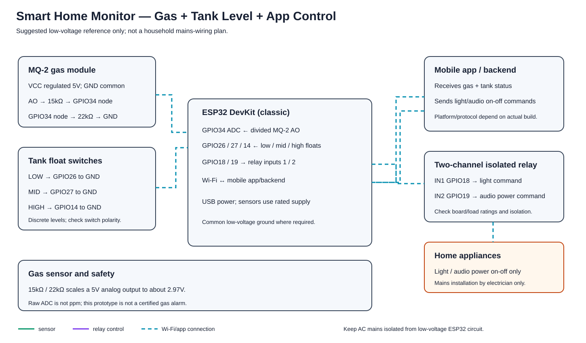

# Smart Home Monitoring: Gas Leakage and Water-Level Detection

This repository contains a **generated reference implementation** based on the project summary in my resume. It demonstrates an ESP32 reading an MQ-2 gas sensor and a float switch, then activating an LED and buzzer when a threshold is reached.

> The exact sensor module and wiring below are assumed choices because the original project files were not supplied. This example has not been verified against the physical project. Confirm your actual components and wiring before powering it.

## Project behavior

- Reads the MQ-2 analog output on an ESP32 ADC input
- Reads a float switch as a single water-level threshold
- Turns on an LED and buzzer if either input indicates an alert
- Prints raw readings and alert states to the Serial Monitor

The gas reading is a **raw ADC value**, not a gas concentration in ppm. The threshold in the firmware is only a placeholder and must be calibrated for the exact module and setup.

## Assumed components

- Classic ESP32 DevKit
- MQ-2 module with analog output (AO)
- Normally-open float switch mounted to close at the chosen water alert level
- LED and 220 Ω resistor
- Active buzzer and an NPN transistor driver with 1 kΩ base resistor
- 15 kΩ and 22 kΩ resistors for the MQ-2 output divider
- Regulated 5V supply for the MQ-2 module, USB supply for the ESP32, jumper wires

## Circuit diagram

## Wiring

| Module / signal | Connect to |
| --- | --- |
| MQ-2 module VCC / GND | Regulated 5V / common GND |
| MQ-2 module AO | Through 15 kΩ / 22 kΩ divider to ESP32 GPIO 34 |
| Float switch | Between ESP32 GPIO 27 and GND; configure it to close at the selected alert level |
| Alarm LED | ESP32 GPIO 18 → 220 Ω resistor → LED anode; cathode → GND |
| Buzzer driver | ESP32 GPIO 19 → 1 kΩ → NPN base; emitter → GND; collector → buzzer negative |
| Buzzer positive | Supply matching the buzzer rating; add a reverse diode across an inductive buzzer |
| Grounds | Join ESP32, MQ-2 supply, switch, LED, and driver grounds |

### MQ-2 analog-output divider

Connect MQ-2 AO → 15 kΩ → ADC node (GPIO34), then ADC node → 22 kΩ → GND. With a 5V AO maximum, the divider node is about 2.97V. This is below the classic ESP32 ADC's documented 11 dB measurement ceiling, but modules vary: verify your module's output and keep the ESP32 input within its ratings. Never connect a 5V analog output directly to an ESP32 GPIO.

Power the MQ-2 module from regulated 5V, not the ESP32 3V3 pin. The MQ-2 heater can consume substantial power. The ESP32 and sensor supply must share ground.

## Firmware

Open [src/smart_home_monitor.ino](src/smart_home_monitor.ino) in Arduino IDE, select **ESP32 Dev Module**, choose the correct serial port, and upload. No extra Arduino library is required.

Open Serial Monitor at **115200 baud**. The code assumes GPIO27 reads LOW when the float switch closes at the alert level. If your switch works the opposite way, invert the water-switch condition in the source.

### Calibration and setup

- The firmware's GAS_THRESHOLD_RAW = 2200 is an arbitrary starting placeholder, not a validated setting.
- MQ-2 readings vary with the exact sensor module, warm-up, environment, and supply. Follow the manufacturer's manual; it specifies at least 48 hours of preheating for standard characterization.
- Use the Serial Monitor to observe readings in a clean-air setup and follow the sensor maker's calibration procedure. Do not infer ppm from this example's raw value.
- Do not release flammable gas to test this project. Use a qualified, controlled test setup if sensor response must be evaluated.

## Safety and limitations

**This educational prototype is not a certified gas alarm and must not be relied on for life safety, property protection, or emergency response. Use a certified gas detector.** MQ-2 sensors respond to multiple gases and smoke, and a simple threshold cannot replace a calibrated detector. The float switch detects one selected level, not a continuous water level.

The wiring diagram is a reference, not a PCB manufacturing schematic. Check sensor pin labels, power ratings, transistor pinout, and buzzer requirements for your exact parts before connecting power.

## References

- [Winsen MQ-2 product information](https://www.winsen-sensor.com/product/mq-2.html)
- [Winsen MQ-2 manual](https://www.winsen-sensor.com/d/files/newpdf/mq-2-%28ver1_6%29---manual.pdf)
- [Espressif Arduino-ESP32 ADC documentation](https://docs.espressif.com/projects/arduino-esp32/en/latest/api/adc.html)

## Author

Abinavu M — Electronics and Communication Engineering student focused on embedded systems and IoT.
